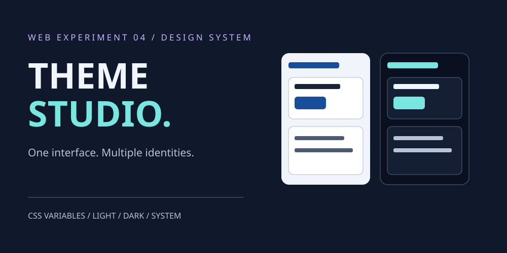

# Theme Studio — CSS Theme Switcher



An interactive design-system playground created for Web Experiment 04. It demonstrates CSS custom properties, reusable components, typography and spacing tokens, and theme switching without a framework.

**Status:** Academic project / implemented frontend prototype. Public deployment and browser-level tests are not yet verified.

## Features

- Light, dark and system-default appearance
- Live response to operating-system theme changes while in system mode
- Saved preference with graceful handling of unavailable browser storage
- Migration of the original theme preference
- Live CSS token swatches and reusable theme-aware cards
- Functional demo action and expandable component details
- Responsive layout, visible keyboard focus and reduced-motion support
- System appearance remains available without JavaScript

## Run locally

Open `index.html` in a browser or run:

```bash
python -m http.server 8000
```

Visit http://localhost:8000. No dependencies or API keys are required.

## Structure

- `index.html` — component playground and appearance controls
- `styles.css` — reusable design tokens and responsive theme rules
- `script.js` — theme resolution, preference persistence and interactions
- `tests/theme.test.js` — theme resolution regression tests
- `assets/cover.svg` — original concept artwork

## Testing

With Node.js 18+:

```bash
node --test tests/theme.test.js
```

Manual browser checks: switch themes, reload, change operating-system appearance, disable local storage, test keyboard navigation and both mobile and desktop layouts.

## Learning objectives

Understand CSS variables, reusable styles (mixin-like utility patterns rather than Sass mixins), media queries, DOM interaction and browser preference persistence.

## Deployment

Host the repository root on a static host. No live URL is listed until verified.
